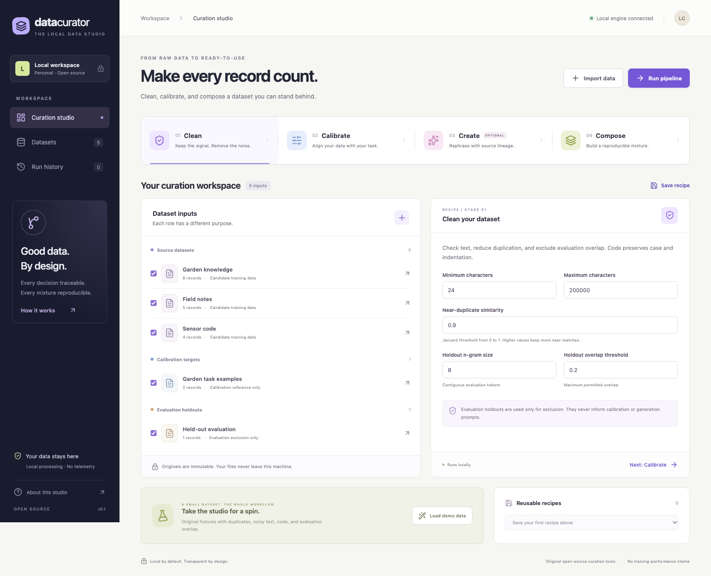

# Data Curator

A local data curation studio for text and code. Import datasets, inspect every
cleaning decision, calibrate toward a task, optionally rephrase with a local model,
and export a reproducible mixture with provenance.

The Python engine, command line, and web UI share the same pipeline. The demo works
without model downloads, API keys, or paid services. Python has no runtime package
dependencies; the interface is React and TypeScript.



## Start locally

Requirements: Python 3.11+, [uv](https://docs.astral.sh/uv/), and Node.js 22.22+ with
npm. Run these commands from the repository root:

```sh
uv sync --extra dev
npm --prefix web ci
npm --prefix web run build
uv run data-curator serve
```

Open **http://127.0.0.1:8765** and choose **Load demo**. The server serves the built
interface and API on loopback. For frontend development, run
`npm --prefix web run dev` in a second terminal; its `/api` requests proxy to the
Python server. No external fonts or analytics are loaded by the application.

The default workspace is `.data-curator/` in the current directory. Choose another
with `data-curator --data-dir /path/to/workspace ...`. Keep this directory private:
it holds original uploads, held-out data, and derived artifacts.

## Four stages, explicit decisions

| Stage | What happens | What you can inspect |
| --- | --- | --- |
| **Clean** | Length and corruption checks, exact and near-duplicate removal, held-out overlap exclusion | Rejection reasons, overlap details, duplicate references |
| **Calibrate** | Transparent quality components and task/target relevance scoring | Per-record scores and thresholds |
| **Create** | Optional source-grounded rephrasing through an explicitly configured local model | Parent records, model, prompt/output hashes; generated output is screened again |
| **Compose** | Seeded sampling without replacement under source weights and a budget | Requested/realized mixture, shortages, record IDs, output hash |

Dataset roles are separate:

- **Source:** candidates for cleaning, generation, and final export.
- **Target:** examples of the desired topic/task used for relevance calibration.
- **Holdout:** evaluation references used only to exclude overlap. Their text is
  never passed to the relevance scorer or generator.

Targets and holdouts are not exported as training records. The inspector displays
imported content as text, including HTML and code; it does not execute it.

## Import your data

Upload UTF-8 JSONL/NDJSON, a JSON array, CSV with a text column, a text/Markdown file,
or a supported code file. A plain text or code file becomes one record. JSONL is
recommended when a file contains multiple documents:

```jsonl
{"text":"A short explanation of a topic.","kind":"text","metadata":{"license":"CC0-1.0","source":"my-notes"}}
{"text":"def identity(value):\n    return value\n","kind":"code","metadata":{"license":"MIT"}}
```

Use `text_field`/`--text-field` for a different content column. Extra columns and
user-supplied IDs are retained in metadata; internal IDs are assigned by the
application. Code indentation and case are preserved. A declared license records
what you supplied; the application does not determine dataset rights for you.

Imports are atomic and bounded: **20 MiB per file, 10,000 records per dataset, and
200,000 characters per record**. Metadata is bounded to 16 KiB per record and eight
levels of nesting. Empty, malformed, non-UTF-8, and oversized inputs return errors
without leaving a partial dataset. A run is limited to 50,000 input records and
20,000,000 input characters. The pipeline operates in memory; these are guardrails, not
a guarantee that every maximum-size workload is fast on every computer.

## Command line

```sh
# Original offline fixtures with planted duplicates, corruption and holdout overlap.
uv run data-curator demo
uv run data-curator datasets

# Import a source or a separate calibration/evaluation reference.
uv run data-curator import notes.jsonl --name "Notes" --role source --license CC0-1.0
uv run data-curator import targets.jsonl --role target
uv run data-curator import evaluation.jsonl --role holdout

# Save defaults, edit the JSON, then run the same engine used by the studio.
uv run data-curator recipe > recipe.json
uv run data-curator run --recipe recipe.json --seed 42 --max-records 100
uv run data-curator runs

# Replace RUN_ID with the ID printed by the run command.
uv run data-curator export RUN_ID --output exports/my-run
```

`run` includes all imported datasets unless `--dataset ID` is supplied; repeat that
flag for each selected source, target, and holdout. It waits for completion and
prints machine-readable JSON; progress goes to stderr. `Ctrl+C` requests
cancellation. The web UI also supports cancellation and retry; retry creates a
new run ID with the same immutable inputs and recipe.

An export contains `curated.jsonl`, `rejected.jsonl`, `manifest.json`, `recipe.json`,
and `report.json`. Existing files are protected unless `--overwrite` is explicit.
The workspace additionally retains the full decision log, input snapshot, and
`generated.jsonl` containing every model candidate, including rejected candidates.

## Optional local generation

**Create is disabled by default.** Disabled generation is visibly skipped; the
application never substitutes a template rewrite or pretends a model was called.
To use it, first run an installed local model with an OpenAI-compatible chat
completions API, then set the recipe's `create` fields:

```json
{
  "create": {
    "enabled": true,
    "endpoint": "http://127.0.0.1:11434/v1",
    "model": "your-installed-model",
    "max_records": 5,
    "temperature": 0,
    "max_output_tokens": 1024,
    "timeout_seconds": 30,
    "retries": 1
  }
}
```

Only literal loopback HTTP addresses are accepted. The adapter does not follow
redirects, discover environment proxies, read credentials, install models, or
contact cloud inference services. Configured inference failures fail the run
explicitly. Review generated content: grounding and filtering do not guarantee
factual accuracy or code equivalence. Also review your model server's own network
and retention settings; it is a separate process.

For the web API, set the allowed endpoint when starting the server with
`data-curator serve --model-endpoint http://127.0.0.1:11434/v1` or
`DATA_CURATOR_MODEL_ENDPOINT`; recipe endpoints must match this administrator
setting. A CLI run can use a loopback endpoint from its local recipe file.

Deterministic stages produce identical artifacts for the same stored inputs,
recipe, seed, and engine version. Generation itself may vary even at temperature
zero; preserve its actual outputs for replay. All token counts are **estimates**,
not measurements from a model tokenizer. See [algorithm details](docs/ALGORITHMS.md).

## API and artifacts

The same local API drives the studio. Useful endpoints include:

| Method | Path | Purpose |
| --- | --- | --- |
| GET | `/api/health` | Local health check |
| GET / POST | `/api/datasets` | List / import datasets |
| POST | `/api/demo` | Load the original fixtures idempotently |
| GET | `/api/recipe/default` | Default recipe |
| GET / POST | `/api/runs` | List / start persisted runs |
| GET | `/api/runs/:id` | Status, progress and summary |
| POST | `/api/runs/:id/cancel` | Request cancellation |
| POST | `/api/runs/:id/retry` | Create a fresh attempt |
| GET | `/api/runs/:id/records` | Paginated output |
| GET | `/api/runs/:id/decisions` | Paginated decision log |
| GET | `/api/runs/:id/export` | Download curated JSONL |
| GET | `/api/runs/:id/manifest` | Reproducibility manifest |
| GET | `/api/runs/:id/generated` | Every generated candidate with lineage |
| GET / POST | `/api/recipes` | List / save reusable recipes |

See [architecture and persistence](docs/ARCHITECTURE.md) for request examples and
artifact contents. The local server is intended for a trusted single-user
workstation; it is not an authenticated public service.

## Validate changes

```sh
uv run ruff check .
uv run mypy
uv run pytest
npm --prefix web run lint
npm --prefix web run build
cd web && npx playwright install chromium && cd ..
npm --prefix web run test:e2e
```

The suite covers pipeline decisions, Unicode and code handling, holdout isolation,
determinism, local generation failure paths, persistence, invalid input, server
boundaries, cancellation/retry, and real browser flows. Browser installation is a
development prerequisite and is never triggered by the application itself.

The [planted-fixture audit](docs/fixture-audit.json) records the original demo's
17 source records, 13 retained records, and four expected rejections. Code case,
CJK text, math, and inert HTML remain present. Repeated output bytes match. These
small fixture results establish behavior only, not training quality or scale.
Reproduce the audit with `uv run python scripts/audit_demo.py`.

## Scope and license

This is an inspectable local application, not a distributed curation platform or a
production multiuser service. Heuristic scores are review aids, lexical overlap
does not detect every semantic leak, and no training-quality or compute-efficiency
improvement has been established. Read the [security model](docs/SECURITY.md) and
[reference notes](docs/REFERENCE_NOTES.md).

Original code and fixtures are [MIT licensed](LICENSE). Dependencies retain their
own licenses; see [third-party notices](THIRD_PARTY_NOTICES.md). Imported datasets
and configured model weights retain their existing terms.
