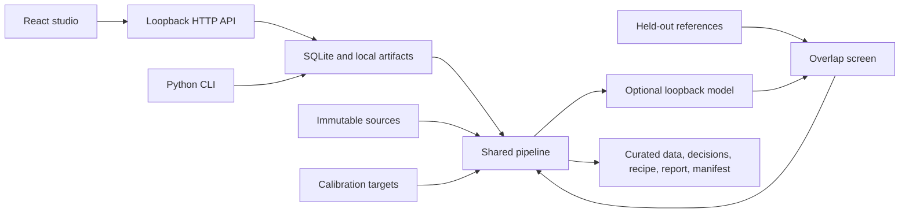

# Architecture and persistence

The application has one curation implementation. Browser requests and CLI commands
both pass through `Store`, which invokes `pipeline.run_pipeline`. The pipeline can
also run directly on in-memory dataset dictionaries for tests and integrations.



The holdout arrow represents exclusion only: holdout contents do not become
calibration examples or generation prompt material.

## Modules

| Module | Responsibility |
| --- | --- |
| `ingest.py` | Bounded UTF-8 parsing and schema validation; no code execution |
| `pipeline.py` | Recipe validation, four stages, decisions, summaries and canonical exports |
| `generation.py` | Explicit local-model requests, bounded retries and synthetic lineage |
| `store.py` | Immutable dataset identities, SQLite state, one active worker and artifacts |
| `server.py` | Loopback API, paginated reads, downloads and static interface |
| `cli.py` | Commands using the same store and engine |
| `demo.py` | Small, original fixtures; no external datasets |
| `web/src` | React interface and typed API client |

Python runtime code uses the standard library. Development tooling is optional;
the web dependencies are fixed in `web/package-lock.json`. `uv.lock` records the
Python development environment.

## Dataset identity and originals

Each import receives a server-generated dataset ID and dataset-scoped record IDs.
User filenames are labels used to choose a parser, not filesystem destinations.
User record IDs are retained as metadata. A dataset records its role, declared
license, upload SHA-256, parsed-record SHA-256, record count, and creation time.

The default local layout is:

```text
.data-curator/
  curator.sqlite3
  worker.lock
  datasets/<dataset-id>/
    original.upload
    records.jsonl
    metadata.json
  runs/<run-id>/
    input_snapshot.json
    curated.jsonl
    rejected.jsonl
    generated.jsonl
    decisions.jsonl
    recipe.json
    report.json
    manifest.json
```

CLI and API imports preserve uploaded bytes in `original.upload`, separate from
derived records. The programmatic store API can accept records without uploaded
bytes, in which case that file is absent. Parsed records are checksum-verified on
load. The application does not edit imported datasets in place. A referenced
dataset cannot be deleted while a persisted run depends on it.

## Run lifecycle

A run transitions from `queued` to `running`, then to `completed`, `cancelled`, or
`failed`. SQLite records the recipe, selected dataset IDs, status, progress, and
final summary. The API returns immediately after scheduling; the UI polls status.
The CLI waits and reports progress separately from its JSON output.

Only one run can be active for a data directory, including across CLI and server
processes. A file lease and a SQLite uniqueness constraint enforce this. Independent
workspaces can run separately. Cancellation is cooperative: the worker checks a
cancellation event between bounded operations and during local inference waits.
Cancellation does not modify originals. Retry creates a new run identity.

Artifact writes use temporary files and atomic replacements. Completed run
artifacts are installed from a temporary directory before the completed status is
published. On reopening a workspace, unfinished runs without an active worker
lease are marked failed/interrupted and can be retried. This is recoverable local
job persistence, not distributed scheduling or checkpoint continuation.

## HTTP examples

Create a small source dataset:

```sh
curl http://127.0.0.1:8765/api/datasets \
  -H 'Content-Type: application/json' \
  --data '{"name":"Notes","role":"source","filename":"notes.jsonl","content":"{\"text\":\"An original document about local data curation.\"}\n","license":"CC0-1.0"}'
```

Start a run with selected IDs returned by dataset imports:

```json
{
  "dataset_ids": ["SOURCE_DATASET_ID", "TARGET_DATASET_ID", "HOLDOUT_DATASET_ID"],
  "recipe": {
    "name": "My local recipe",
    "seed": 42,
    "compose": {"max_records": 100}
  }
}
```

Send that object to `POST /api/runs`. Omitted recipe fields receive validated
defaults. Unknown fields and invalid values are rejected. Dataset IDs are actual
returned IDs, not filenames or arbitrary paths. A run needs at least one source;
targets and holdouts are optional, and omitted roles cannot provide their checks.

Records use `offset` and `limit` pagination. Decisions also accept an optional
`action` filter such as `reject`. Errors are JSON objects with an `error` string;
invalid requests, missing resources, conflicts, and oversized bodies have distinct
HTTP error statuses. Poll terminal status before requesting artifacts.

## Reproducibility boundary

The recipe, input hashes, seed, algorithm versions, stage totals, output hashes,
and realized mixture belong to the deterministic manifest. Operational identifiers
and timestamps belong to the run record. Repeating a run on the same imported
dataset identities keeps deterministic artifacts stable; reimporting identical
bytes creates new provenance IDs and therefore changes identity-bearing artifacts.

Model generation is a separate nondeterministic boundary. Store the actual model
responses, their hashes, and lineage when retaining a generation run. A recorded
seed is not a promise of identical generation from another model server or version.
Review the manifest and retained output, not only a UI success indicator.

## Capacity

This version materializes datasets, scoring features, and derived records in
memory. Import limits are 20 MiB, 10,000 records, and 200,000 characters per record;
parsed dataset storage is capped at 40 MiB. A run accepts at most 100 datasets,
50,000 total records, and 20,000,000 input characters. Indexes and JSON objects consume
additional memory. There are no GPU, Ray, Spark, or model download dependencies.

For larger workloads, a future adapter could move storage, indexing, and execution
to a streaming or distributed engine while preserving these data contracts and
audit artifacts. No such scale adapter is included or implied today.
